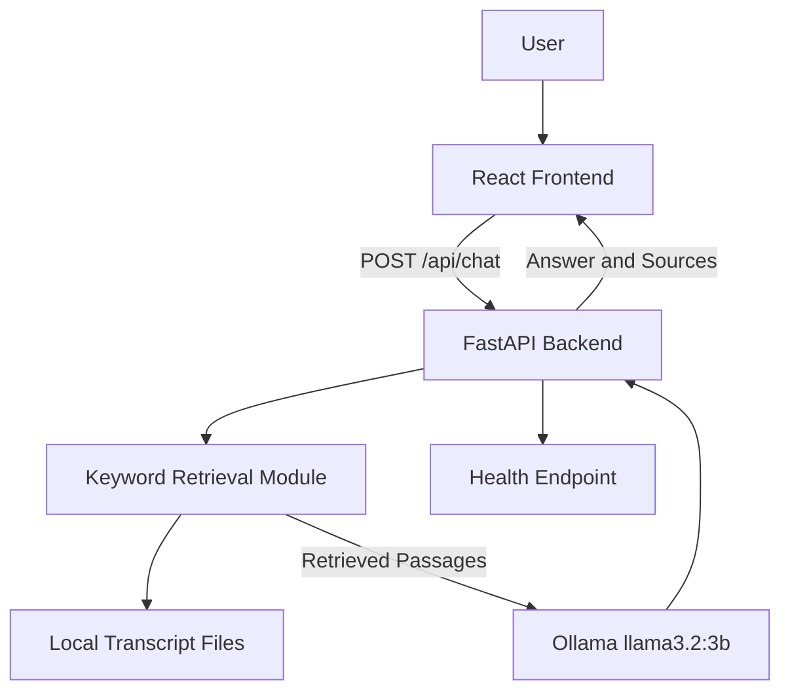

# Architecture — Lenny Growth Assistant

## 1. Overview

The application uses a React frontend, a FastAPI backend, a local knowledge base, and an Ollama language model.

The current implementation is designed for local development. PostgreSQL persistence, cloud model integration, and production deployment are not yet implemented.

## 2. Architecture Diagram



## 3. Components

### Frontend

**Technology:** React, Vite, ReactMarkdown, remark-gfm

Responsibilities:

* Collect user questions.
* Display conversation messages.
* Render Markdown responses.
* Show source links returned by the backend.
* Provide a new-chat action.

### Backend API

**Technology:** Python, FastAPI, Uvicorn

Current endpoints:

* `GET /` — basic API status message.
* `GET /health` — health response.
* `POST /api/chat` — validates a question, retrieves context, invokes the model, and returns an answer with source metadata.

### Knowledge Retrieval

**File:** `backend/knowledge.py`

Responsibilities:

* Read local Markdown and text files.
* Tokenize questions and paragraphs.
* Rank paragraphs using keyword overlap.
* Return relevant passages for the response context.

### Language Model

**Technology:** Ollama, `llama3.2:3b`

Responsibilities:

* Generate an answer using retrieved passages.
* Follow instructions to avoid unsupported claims.
* Return an uncertainty response when evidence is insufficient.

### Knowledge Base

**Location:** `knowledge_base/`

Contains local source material used for retrieval. Source attribution should be preserved, and public redistribution must follow the original material's license and terms.

## 4. Request and Response

Example request:

```json
{
  "message": "How much time do executives spend recruiting?"
}
```

Example response shape:

```json
{
  "reply": "An answer based on retrieved context.",
  "sources": [
    {
      "filename": "brian-halligan.md",
      "title": "Source title",
      "url": "https://www.youtube.com/watch?v=3UyitfSbY6c"
    }
  ]
}
```

The answer and source details depend on the retrieved material and model response.

## 5. Error Handling

* Invalid input is rejected by request validation.
* Model errors are returned as an HTTP error.
* Unexpected backend errors return a generic error message.
* The frontend displays an error message when a request fails.

## 6. Configuration and Secrets

A root `.env.example` file documents planned settings for the model and database.

**Current status:** The backend does not yet load all these values. The model is configured directly in the backend code. No cloud provider or PostgreSQL connection is currently active.

Secrets must not be committed to GitHub.

## 7. Planned Architecture Improvements

1. Load settings through a validated configuration module.
2. Add a provider interface for Ollama and one cloud model provider.
3. Add PostgreSQL storage for sessions and messages.
4. Improve retrieval with better chunking and semantic search.
5. Implement the dedicated essay-writing skill.
6. Add an isolated, safe artifact viewer.
7. Add automated tests and deployment configuration.

## 8. Reliability Considerations

* Check model availability before processing requests.
* Set sensible timeouts for model calls.
* Log diagnostic details without exposing secrets.
* Handle empty retrieval results and database failures gracefully.
* Test retrieval quality and answer grounding with representative questions.
